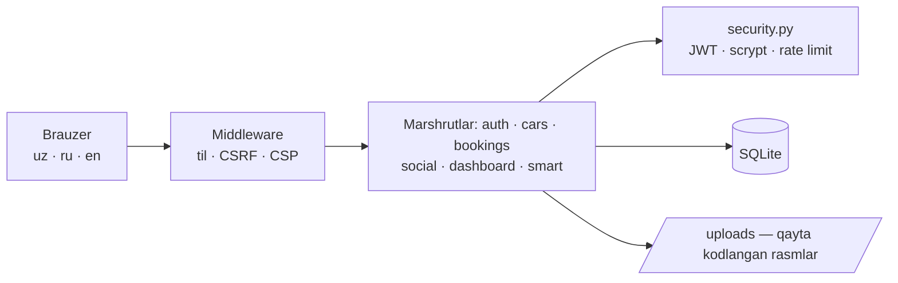
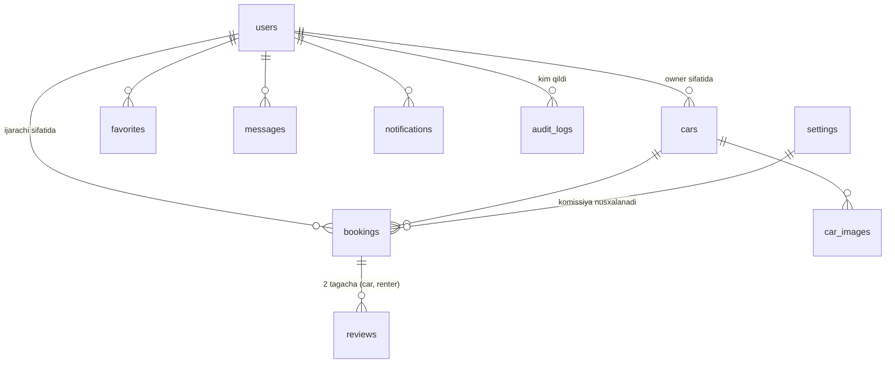
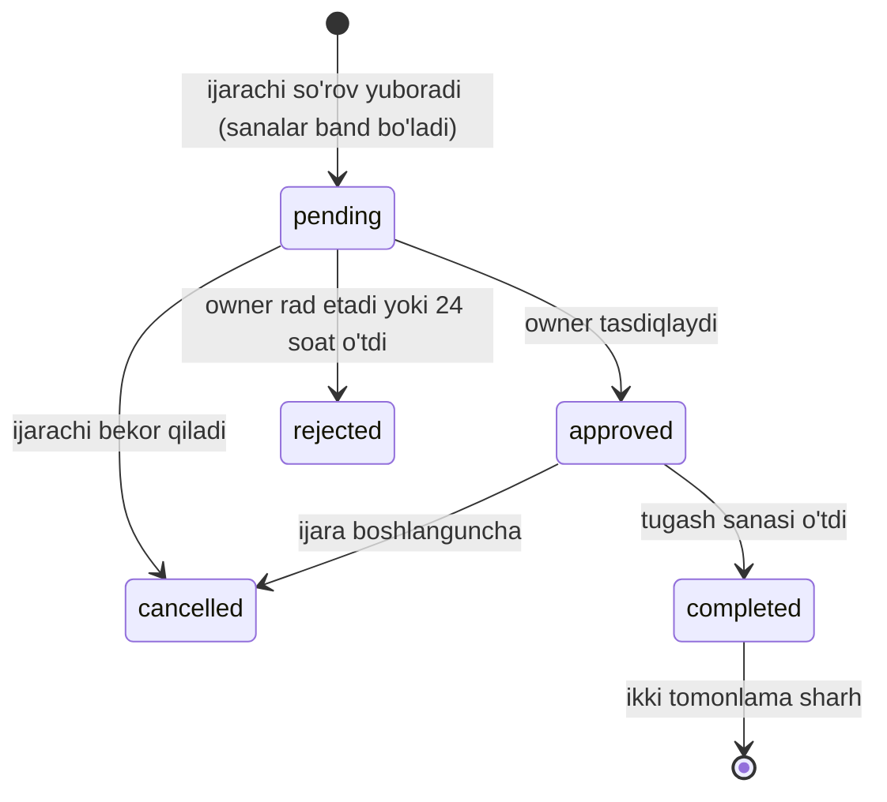

# 🚗 CarRent — avtomobil ijarasi platformasi

> *O‘zingizga mos avtomobilni toping. Ishonch bilan yo‘lga chiqing.*

CarRent — O‘zbekiston uchun avtomobil ijarasi veb-platformasi. Bitta akkaunt bilan avtomobil ijaraga olish **va** o‘z avtomobilini ijaraga berish mumkin. Interfeys uch tilda: **o‘zbek, rus, ingliz**.

**Hal qilinadigan real muammolar:**
- **Ikki marta band qilish** — bitta sanani ikki kishiga berib yuborish. Tizim buni tranzaksiya darajasida to‘xtatadi (20 ta parallel so‘rovdan faqat bittasi o‘tishi test bilan isbotlangan).
- **Soxta reyting** — sharh faqat yakunlangan ijaradan keyin, har tomon bir marta qoldiradi.
- **Narxni bilmaslik** — owner uchun o‘xshash e’lonlardan tavsiya etiladigan narx; ijarachi uchun barcha summalar bron qilishdan oldin qatorma-qator ko‘rinadi.
- **Ikki akkaunt muammosi** — bir odam ham ijarachi, ham owner: ma’lumotlar bitta profilda, rejim almashganda hech narsa yo‘qolmaydi.

---

## ✅ Nima tayyor (hammasi sinovdan o‘tgan)

| Modul | Holat |
|---|---|
| Ilova qobig‘i | ✅ Kompyuterda **chap panel** (bo‘limlar, rejim, sozlamalar), telefonda **pastki tablar** + yon menyu |
| Telefon versiyasi | ✅ 360–1920 px; Wi-Fi orqali telefonda ochish (`run-phone.bat`); PWA manifest va oflayn sahifa (o‘rnatish HTTPS’da ishlaydi) |
| Ro‘yxatdan o‘tish, kirish | ✅ **Email yoki telefon** bilan kirish (istalgan formatda: `+998 90…`, `90 123 45 67`), parol kuchi, ko‘rsatish/yashirish |
| Parolni tiklash | ✅ **Email yoki SMS** orqali 6 xonali kod: 10 daqiqa, 5 urinish, 60 s kutish, kuniga 10 ta; akkaunt borligi oshkor qilinmaydi; tiklangach barcha sessiyalar yopiladi |
| Email / telefonni tasdiqlash | ✅ Kod bilan; tasdiqlangan foydalanuvchiga ✓ belgisi |
| Sozlamalar | ✅ Profil va avatar, email almashtirish (kod bilan), parol, **faol sessiyalar** (har birini yopish, hammasidan chiqish), bildirishnoma kanallari, telefonni yashirish, til, akkauntni o‘chirish |
| Uch til (uz / ru / en) | ✅ 970 ta kalit × 3 til, sahifa qayta yuklanmaydi; server xatolari ham tanlangan tilda |
| Sana maydonlari | ✅ Brauzer tilidan qat’i nazar `30.10.2026` ko‘rinishidagi namuna, avtomatik nuqta, o‘z kalendari |
| Forma izohlari | ✅ Har bir maydon ostida “qanday to‘ldirish” izohi va namunasi (uch tilda) |
| Avtomobil qo‘shish | ✅ 6 bosqich, narx tavsiyasi, qoralama, oldindan ko‘rish |
| Rasmlar | ✅ Burchaklar ro‘yxati (old, orqa, yon, salon, panel, yukxona), **telefon kamerasi**, brauzerda siqish, ← → va sudrab tartiblash, yorliq, asosiy rasm; serverda qayta kodlash, EXIF/GPS o‘chiriladi |
| Galereya | ✅ To‘liq ekran, klaviatura va barmoq bilan surish, yorliqlar |
| Qidiruv va filtrlar | ✅ 13 mezon, server tomonida, URL’da saqlanadi |
| Bron va kalendar | ✅ Narx serverda muzlatiladi; pending 24 soatda bo‘shaydi; **owner kunlarni yopa oladi** (ta’mir va h.k.) |
| Onlayn to‘lov | ✅ Click (SHOP API) va Payme (Merchant API) integratsiyasi yozilgan va imzo/parol tekshiruvi bilan test qilingan; **sinov to‘lovi** faqat dev/demo’da, sariq TEST belgisi bilan; kvitansiya (chop etish/PDF) |
| Qaytarish va o‘tkazmalar | ✅ Bekor qilinganda to‘lov qaytarishga yuboriladi; owner balansi, admin o‘tkazmani qayd etadi |
| Shikoyatlar | ✅ E’lon ustidan shikoyat → admin: yashirish / bloklash / rad etish |
| Ma’lumot markazi | ✅ Biz haqimizda, Qanday ishlaydi, Tariflar, Xavfsizlik, FAQ, Aloqa, Qoidalar — **bitta sahifada** |
| Chat, bildirishnomalar, sharhlar, sevimlilar, tavsiyalar | ✅ |
| Kabinetlar va admin | ✅ Daromad, to‘lovlar, balans, shikoyatlar, audit jurnali |

## 🆕 6-versiyada qo‘shilganlar — har bir raqam bosiladi, admin to‘liq boshqaradi

| Modul | Nima qiladi |
|---|---|
| 🔍 **Batafsil ko‘rish (drill-down)** | Admin, owner va ijarachi dashboardlari hamda Hisobotlardagi **har bir karta, grafik ustuni, holat chizig‘i, shahar/kuzov/oy qatori va jadval qatori** bosiladi. O‘ng tomonda oyna ochiladi: aynan shu raqam qaysi bronlar, **qaysi mashinalar (rasmi bilan), kimniki, kim ijaraga olgan**, qachon va qanchaga ekanligidan iborat. Ustida xulosa (soni, jami summa, komissiya, owner ulushi, kunlar, mashinalar soni), qidiruv va Excel (CSV) yuklab olish bor. Ko‘rish chegarasi serverda: owner faqat o‘z mashinalarini, ijarachi faqat o‘z bronlarini ko‘radi (`/api/drill`) |
| ℹ️ **Raqamlar izohi** | Har bir kartaning pastida “bu raqam nimani anglatadi” degan qisqa izoh bor (masalan, “Faol (30 kun) — oxirgi 30 kunda bron qilgan, e’lon yangilagan yoki xabar yozganlar”) |
| 👤 **Admin: foydalanuvchi sahifasi** | `admin.html#user/ID`. Profil, tasdiqlanganlik, oxirgi faollik; ijarachi va owner sifatidagi raqamlari (bosiladi), balans va komissiya qarzi; **xavf belgilari** (ko‘rilmagan shikoyat, ochiq nizo, ko‘p bekor qilish, past baho, qarz, ogohlantirishlar). Bo‘limlar: Bronlar, Mashinalari, To‘lovlar, Shikoyatlar (unga va u yozgan), Nizolar, Sharhlar, Xavfsizlik (faol sessiyalar), Tarix (audit) |
| 🛠 **Admin amallari** | Bloklash (sabab bilan; hamma qurilmadan chiqariladi) va blokdan chiqarish, **ogohlantirish** (foydalanuvchiga bildirishnoma boradi), ichki eslatma, email/telefonni tasdiqlash yoki bekor qilish, barcha qurilmalardan chiqarish, barcha e’lonlarni yashirish/qaytarish, mashinani alohida yashirish, sharhni o‘chirish, **bronni admin sifatida bekor qilish** (sabab bilan; onlayn to‘langan bo‘lsa — siyosat bo‘yicha yoki to‘liq qaytarish). Har bir amal audit jurnaliga yoziladi |
| 🚩 **Shikoyatdan odamga** | Har bir shikoyatda **kim ustidan** ekani (e’lon egasi, xabar yuboruvchi, sharh muallifi) alohida blokda ko‘rinadi — bosilsa o‘sha odamning sahifasi ochiladi. Shikoyat oynasidan to‘g‘ridan-to‘g‘ri “Ogohlantirish” yoki “Bloklash” |
| 🔐 **Kirish oynasi** | Maydonlar, sarlavha va tugma halqaga mutanosib kattalashtirildi |

Testlar: **95 ta**.

## 🆕 5-versiyada qo‘shilganlar — haqiqiy tizimga o‘tish

| Modul | Nima qiladi |
|---|---|
| 🚀 **Jonli rejimga o‘tish ustasi** | `python -m scripts.setup_live` — savollar bilan `.env` tuzadi: sayt manzili, Gmail SMTP (ulanib ko‘radi va sinov xati yuboradi), Eskiz (kirib ko‘radi va sinov SMS yuboradi), Click/Payme kalitlari (callback manzillarini chiqaradi). Demo rejim, test qutisi va test to‘lovlari o‘chiriladi. Xohlasangiz demo mashina/foydalanuvchilar o‘chiriladi (oldin baza nusxasi olinadi) va haqiqiy admin yaratiladi. Eski `.env` → `.env.bak` |
| 🔑 **Parol qoidalari** | Kamida 8 belgi, katta harf, kichik harf, raqam, belgi. Ro‘yxatda, parolni tiklashda va sozlamalarda har bir shart yozib turiladi, bajarilgani yashil bo‘ladi. Server ham aynan shu qoidalarni tekshiradi |
| ⏱ **Kod muddati** | 3 daqiqa (`CODE_TTL_MIN`), ekranda teskari sanoq; tugasa “yangisini so‘rang” |
| 📨 **Kod kanallari ochiq aytiladi** | Email/SMS ulanmagan bo‘lsa — o‘sha tugma o‘chiq va “ulanmagan, kod test qutisiga yozildi” degan ogohlantirish chiqadi (avval bu yashirin edi — shuning uchun SMS kelmagan) |
| ↩️ **Parolni tiklash** | “Orqaga” endi email/SMS tanlash qadamiga qaytaradi; “Boshqa usul / manzil” tugmasi |
| 🔔 **Kabinetlar bo‘yicha bildirishnomalar** | Har bir bildirishnoma va xabar Owner yoki Ijarachi kabinetiga tegishli. Qo‘ng‘iroqcha va hisoblagichlar faqat joriy kabinetnikini ko‘rsatadi; boshqa kabinetdagi yangilar “Owner kabinetida 2 ta yangi — o‘tish” deb chiqadi. Yangi xabar kelsa Telegram kabi oyna: kimdan, qaysi kabinet uchun, qisqa matn — bossangiz kerakli kabinetga o‘tib ochadi |
| 💬 **Xabarlar** | “Joriy kabinet / Hammasi” yorliqlari, har suhbatda “Mening mashinam” yoki “Ijara” belgisi |
| ⚙️ **Sozlamalar** | Har bo‘lim (Profil, Tasdiqlash, Xavfsizlik, Bildirishnomalar, Maxfiylik, Til, Akkaunt) alohida oyna |
| 📊 **Admin kartalari bosiladi** | “Jami foydalanuvchilar”, “Faol”, “Bloklangan”, “Bronlar”, “Aylanma” va h.k. — bosilsa tegishli ro‘yxat/hisobot filtri bilan ochiladi; foydalanuvchilarda filtr chiplari (ijarachi, owner, faol, yangi, bloklangan, admin) |
| 📅 **Batafsil ≠ Band qilish** | “Batafsil” — to‘liq sahifa (rasmlar, shartlar, sharhlar). “Band qilish” — tezkor oyna: kalendardan sana tanlash, narx hisobi, izoh va so‘rov yuborish shu yerning o‘zida |
| 🗺 **Barcha hududlar** | Bosh sahifada 14 hudud; e’loni yo‘qlari “Tez orada” bo‘lib turadi va birinchi e’lon chiqishi bilan avtomatik faollashadi |
| 🖼 **Kirish oynasi surati** | Haqiqiy mashina suratlari (fon olib tashlangan) “showroom” sahnasida |

### To‘lov tizimlarini ulash
**Click** (docs.click.uz): merchant kabinetida servis yarating → `CLICK_SERVICE_ID`, `CLICK_MERCHANT_ID`, `CLICK_SECRET_KEY`. Prepare va Complete uchun bitta manzil: `https://SAYT/api/payments/click`.
**Payme** (developer.help.paycom.uz): business.paycom.uz da kassa → `PAYME_MERCHANT_ID`, `PAYME_KEY` (sinovda test kalit). Endpoint: `https://SAYT/api/payments/payme`. Sinov: `PAYME_TEST=true` (test.paycom.uz), sandbox’dagi barcha testlar o‘tgach `false`.
Ikkalasi ham yuridik shaxs/YaTT shartnomasi va **https** manzilni talab qiladi.

Testlar: **89 ta**.

## 🆕 4-versiyada qo‘shilganlar

| Modul | Nima qiladi |
|---|---|
| 🗺 **Viloyat + tuman** | 14 hudud va ularning tumanlari (`static/geo/regions.json` — bitta fayl, server ham, sahifalar ham shuni o‘qiydi). Ro‘yxatdan o‘tishda, sozlamalarda, e’lon formasida, qidiruv filtrida va maslahatchida: viloyat tanlansa — faqat o‘sha viloyat tumanlari chiqadi. Server tumanning viloyatga tegishliligini tekshiradi. Eski yozuvlar (“Toshkent”) avtomatik “Toshkent shahri” ga o‘tkaziladi |
| ☎️ **Telefon shabloni** | Barcha telefon maydonlarida `+998 90 123 45 67` — bo‘shliqlar yozish paytida qo‘yiladi, `+998` o‘chmaydi; ko‘rsatishda ham shu ko‘rinish |
| 💰 **Narx formatlash** | Barcha pul maydonlarida `600 000` (yozish paytida ham); serverga raqam bo‘lib boradi |
| 🔎 **Marka/model takliflari** | Qidiruvda CarRent’dagi barcha mashinalar nomi (e’lonlar soni bilan); e’lon formasida markaga mos modellar |
| ✨ **Yangi qulayliklar** | Klimat-kontrol, 360° kamera, videoregistrator, ISOFIX, kalitsiz kirish, o‘rindiq ventilyatsiyasi, tom bagajnigi, qishki shinalar, Wi-Fi, simsiz quvvatlagich, uy hayvoni mumkin, yo‘lak nazorati |
| 🧭 **Realistik ikonkalar** | Maslahatchida 3D ikonkalar (Microsoft Fluent Emoji, MIT litsenziya — `static/img/adv/`) |
| 🔐 **Kirish oynasi** | Halqa ekran balandligiga moslashadi (forma pastga tushib ketmaydi); past ekran/zoomda ixcham karta; zoomda yozuv maydon ustiga tushib qolish xatosi tuzatildi; chap rasmlar tabiiy ranglarda |
| 💵 **Komissiya qarzi** | Joyida to‘langan ijaralarda owner platformaga komissiya qarzdor bo‘ladi — kabinetda ko‘rinadi; admin “Naqd to‘landi” yoki “Balansdan ushlash” bilan yopadi. Yechib olinadigan summa qarzni hisobga oladi |
| ⚖️ **Nizolar** | Bron ishtirokchisi muammo ochadi (shikast, kelmaslik, kechikish, depozit, e’londagidek emas, to‘lov, yoqilg‘i/probeg); ikkinchi tomon javob yozadi; admin ko‘rib chiqadi va izohli qaror chiqaradi (kompensatsiya, kerak bo‘lsa aybdorni bloklash). Hamma bosqichda bildirishnoma. Ijara tugaganidan keyin 30 kun ichida |
| 📲 **Haqiqiy SMS/email** | Eskiz: token eskirsa avtomatik qayta kirish, yetkazilganlik holati (callback, HMAC imzo), qisqa SMS shablonlari (moderatsiyaga tayyor). Admin “SMS va email” bo‘limi: kanal holati, sinov xabari (provayderning haqiqiy javobi bilan), yuborish jurnali (kod va matn saqlanmaydi) |

### SMS’ni haqiqatan ishga tushirish (Eskiz.uz)
1. my.eskiz.uz da ro‘yxatdan o‘ting, balansni to‘ldiring.
2. Admin panel → **SMS va email** bo‘limidagi shablonlarni Eskiz kabinetida “Shablonlar”ga aynan shunday yuboring (moderatsiya 1–2 kun).
3. `.env` ga yozing: `ESKIZ_EMAIL=...`, `ESKIZ_PASSWORD=...` (`ESKIZ_FROM=4546` — standart).
4. Serverni qayta ishga tushiring → **SMS va email** → “Sinov xabari yuborish”.

Email (Gmail): 2 bosqichli himoya → “App passwords” → `.env`: `SMTP_HOST=smtp.gmail.com`, `SMTP_PORT=587`, `SMTP_USER=...@gmail.com`, `SMTP_PASSWORD=<16 belgili parol>`.

> Yetkazilganlik holati (callback) Eskiz serveri saytingizga kira olishi uchun `PUBLIC_URL` `https://` bilan boshlanishi kerak (Render’ga joylangandan keyin).

## 🆕 3-versiyada qo‘shilganlar

| Modul | Nima qiladi |
|---|---|
| 🧭 **Maslahatchi** (`/advisor.html`) | 4 qadamli savolnoma: maqsad (shahar, oila, uzoq safar, tog‘, biznes, to‘y, yuk), yo‘lovchilar va yuk, byudjet/shahar/sana, ustuvorliklar (tejamkorlik, qulaylik, xavfsizlik, nufuz, arzonlik), uzatma, haydovchi tajribasi, kerakli qulayliklar. Natija: har bir mashinaga **moslik foizi**, “nega mos” (✓) va “nimaga e’tibor bering” (⚑) sabablari, “Eng mos / Eng arzon / Eng tejamkor” belgilari, sanalar berilsa jami narx, maqsadga oid maslahatlar. Mos mashina bo‘lmasa shartlar bosqichma-bosqich yumshatiladi va bu ochiq aytiladi. Model qoidaviy va shaffof — pullik ko‘tarish yo‘q |
| 📊 **Hisobotlar** (owner, ijarachi, admin) | Davr tanlash (7 kun, bu oy, o‘tgan oy, 30 kun, 3 oy, bu yil, ixtiyoriy), **o‘tgan teng davr bilan solishtirish** (▲/▼ %), oddiy tildagi **xulosalar** (“daromad 39% oshdi”, “Camry 83 kun bo‘sh turdi — narxni ko‘rib chiqing”, “1 ta so‘rov javob kutmoqda”), har bir ko‘rsatkich ostida “bu nima degani” izohi, grafik, jadvallar (avtomobillar, shaharlar, kuzov turlari, top ownerlar, to‘lov usullari, so‘rovlar voronkasi), **Excel (CSV)** va **chop etish / PDF** |
| 💳 **Bekor qilish siyosati** | Ijaragacha 3+ kun — 100%, 1–2 kun — 50% qaytariladi. Bekor qilishdan oldin aniq summa ko‘rsatiladi. Qolgan qism komissiya foizi bo‘yicha bo‘linadi: owner bo‘sh qolgan kunlar uchun kompensatsiya oladi. `qaytarilgan + komissiya + owner ulushi = to‘langan summa` test bilan tekshirilgan |
| 💳 **To‘lovlarim** (ijarachi) | Barcha to‘lovlar, qaytarishlar, kvitansiyalar va siyosat bir sahifada; kvitansiyada qaytarilgan va yakuniy summa |
| 💳 **Pul yechish so‘rovi** (owner → admin) | Owner summani va usulni (karta, bank, naqd) tanlab so‘rov yuboradi; admin “O‘tkazildi” yoki sabab bilan “Rad etish”. Bir vaqtda bitta so‘rov, balansdan oshmaydi. **To‘liq karta raqami saqlanmaydi** — faqat oxirgi 4 raqam |
| 💳 **To‘lov ishonchliligi** | 30 daqiqada tugallanmagan urinishlar avtomatik yopiladi; bron bekor bo‘lsa ochiq urinishlar ham yopiladi. Payme: bitta buyurtmada bitta faol tranzaksiya, kutish paytida bekor qilingan bron uchun pul yechilmaydi, ijara o‘tgach bekor qilib bo‘lmaydi (-31007), `ChangePassword` qo‘llab-quvvatlanadi. **Tuzatilgan xato:** Payme xato javobida undan oldingi holat o‘zgarishi (masalan, vaqti o‘tgan tranzaksiyani yopish) bekor bo‘lib ketardi |
| 🎨 **Kirish / ro‘yxat oynasi** | Chap surat paneli neon forma bilan bir rang tizimiga keltirildi (to‘q dengiz ko‘ki + feruza duotone), logo, sarlavha, sharh kartasi va belgilash katagi ham shu uslubda |

Testlar: **78 ta** (yangi: to‘lov siyosati va so‘rovlar — 11, maslahatchi va hisobotlar — 10).

## ⏳ Haqiqiy kalit kerak bo‘lganlar (ishlayotgandek ko‘rsatilmaydi)

| Funksiya | Nima kerak | Kalitsiz holat |
|---|---|---|
| Haqiqiy email | `SMTP_HOST`, `SMTP_USER`, `SMTP_PASSWORD` | Dev/demo’da kodlar **test pochta qutisiga** (`/dev-inbox.html`, faqat lokal tarmoq) tushadi; productionda tiklash “sozlanmagan” deydi |
| Haqiqiy SMS | Eskiz.uz: `ESKIZ_EMAIL`, `ESKIZ_PASSWORD` | Xuddi shunday |
| Click / Payme | Yuridik shaxs shartnomasi va kalitlari | To‘lov oynasida “ulanmagan” deb ko‘rsatiladi; to‘lov joyida |
| Google / Apple orqali kirish | OAuth kalitlari | Tugmalar ko‘rsatilmaydi |

> Click va Payme kodi rasmiy protokol bo‘yicha yozilgan va avtomatik testlar bilan tekshirilgan, lekin **haqiqiy kalitlar bilan sinab ko‘rilmagan**.

---

## 🆕 v8 yangilanishlari

| Modul | Nima qo‘shildi |
|---|---|
| Bron oldidan tekshiruv | Ism-familiya, telefon, tasdiqlangan email/telefon (va mashina talab qilsa — hujjatlar) to‘ldirilmagan bo‘lsa, bron sahifasida nima yetishmasligi va “To‘ldirish” havolalari chiqadi; server ham bunday bronni qabul qilmaydi. `REQUIRE_VERIFIED_CONTACT=0` bilan o‘chiriladi |
| Admin foydalanuvchini to‘liq boshqaradi | Profilni tahrirlash (ism, email, telefon, hudud, til), vaqtinchalik parol yoki emailga tiklash kodi, hujjat rasmlarini ko‘rish/tasdiqlash/rad etish/o‘chirish, foydalanuvchi o‘rniga hujjat yuklash, kartani o‘chirish, istalgan e’lonni tahrirlash; har amal tarixga yoziladi va foydalanuvchiga xabar boradi |
| Hisobotlar | Har bir KPI, xulosa qatori, grafik jami, jadval qatori, so‘rovlar voronkasi va holatlar diagrammasi bosiladi — owner, ijarachi va admin uchun |
| Maslahatchi | Narx har doim hisobga olinadi: teng moslikda arzoni oldinda, “Eng arzon mos variant” va qancha tejash, bozor o‘rtachasi, tejash maslahatlari, “Eng arzon” tartibi. Owner uchun “Tez ijaraga berish narxi” |

## 🆕 v7 yangilanishlari

| Modul | Nima qo‘shildi |
|---|---|
| Akkauntni to‘liq o‘chirish | Moliyaviy tarix bo‘lmasa — butunlay o‘chiriladi; bo‘lsa — anonimlashtiriladi. Ikkala holatda email/telefon bo‘shaydi va qayta ro‘yxatdan o‘tish mumkin |
| Bank kartalari | Sozlamalar → Bank kartalari: Luhn tekshiruvi, Uzcard/Humo/Visa/Mastercard aniqlanadi; faqat birinchi 6 va oxirgi 4 raqam saqlanadi, CVV saqlanmaydi |
| Xarita va joylashuv | Leaflet + OpenStreetMap (oflayn vendor); e’londa xaritadan nuqta tanlash, “Mening joylashuvim”; ijarachiga aniq manzil faqat bron tasdiqlangach; Yandex/Google/telefon xaritasida ochish; chatda joylashuv yuborish |
| Hujjatlar | Haydovchilik guvohnomasi va pasport/ID-karta rasmlari yopiq papkada saqlanadi; admin tasdiqlaydi; owner “faqat hujjati tasdiqlanganlar” talabini qo‘ya oladi |
| Elektron shartnoma | Bron tasdiqlanganda avtomatik tuziladi (raqam `CR-YYYY-000123`), ikki tomon email kodi bilan imzolaydi, admin tasdiqlagach elektron muhr + QR-kod; `/verify.html` ochiq tekshirish, SHA-256 bilan o‘zgartirilmaganligi nazorati; shablon admin panelda tahrirlanadi; PDF sifatida chop etish |
| Topshirish–qabul (handover) | Olishda va qaytarishda probeg, yoqilg‘i %, tozalik, shikast, 4–8 rasm; ikkinchi tomon tasdiqlaydi yoki e’tiroz bildiradi; ortiqcha km, yoqilg‘i kamomadi avtomatik hisoblanadi va depozitdan ushlab qolinadigan summa ko‘rsatiladi |
| Adminlar | Admin → Foydalanuvchilar → foydalanuvchi → “Administrator qilish”; oxirgi adminni olib tashlab bo‘lmaydi |
| Parol | Ro‘yxatdan o‘tish va parol almashtirishda “Ishonchli parol yaratish”; tiklash ikki bosqichli: kod tekshiriladi → yangi parol |
| Dizayn | Admin va owner boshqaruv paneli (KPI kartalar, daromad grafigi, bandlik kalendari, tasdiq navbati), yangi avtomobil sahifasi, hisobotlar grafigi; admin menyusi 6 guruhga ajratildi |
| Maslahatchi | `static/img/adv/photo/<kalit>.jpg` qo‘yilsa real rasm chiqadi (README.txt ichida nomlar) |

## 🛠 Texnologiyalar

| Qatlam | Tanlov |
|---|---|
| Backend | Python 3.10+, **Starlette** (ASGI; FastAPI shu ustiga qurilgan), Uvicorn |
| Validatsiya | Pydantic v2 (xato matnlari uch tilda) |
| Ma’lumotlar bazasi | SQLite, WAL rejimi, tashqi kalitlar, CHECK cheklovlari; pul — butun so‘m, foiz — basis points |
| Autentifikatsiya | JWT, `httpOnly; SameSite=Lax` cookie; parol — scrypt |
| Rasmlar | Pillow: qayta kodlash, EXIF/GPS o‘chirish, 1600 px gacha kichraytirish |
| Frontend | HTML + CSS + Vanilla JS (build talab qilmaydi), i18n JSON fayllar |
| Testlar | pytest (85 ta) + Playwright brauzer sinovi (asosiy oqimlar) |

### Arxitektura



### Ma’lumotlar bazasi



`bookings` jadvalida narx, komissiya foizi, komissiya va owner ulushi bron paytida yoziladi; `CHECK (commission + owner_payout = total_price)` cheklovi hisob buzilmasligini kafolatlaydi.

### Bron hayot sikli



### Komissiya hisobi (misol)

| Qator | Summa |
|---|---|
| 3 kun × 350 000 | 1 050 000 so‘m |
| Yetkazib berish | 50 000 so‘m |
| **Ijarachi to‘laydi** | **1 100 000 so‘m** |
| Komissiya 10% | 110 000 so‘m |
| **Owner oladi** | **990 000 so‘m** |
| Depozit (alohida, qaytariladi) | 500 000 so‘m |

---

## 🔐 Xavfsizlik

| Tahdid | Himoya |
|---|---|
| Parol o‘g‘irlanishi | scrypt + tuz; kamida 12 belgi, keng tarqalgan parollar rad etiladi, passphrase qo‘llab-quvvatlanadi |
| Brute-force, spam | Login: 5 daqiqada 8 urinish; ro‘yxat: IP’dan soatiga 10 ta; chat: daqiqasiga 30 xabar |
| IDOR / BOLA | Har bir so‘rov egalik bilan filtrlanadi; begona bron, suhbat, e’lon ko‘rinmaydi (testlar bilan isbotlangan) |
| XSS | Barcha matn `esc()` orqali; qat’iy CSP (`script-src 'self'`, `unsafe-eval` yo‘q) |
| CSRF | `SameSite=Lax` + majburiy `X-Requested-With` sarlavhasi |
| SQL injection | Faqat parametrlangan so‘rovlar |
| Zararli fayl | Format baytlar bo‘yicha, Pillow bilan qayta kodlash, EXIF/GPS o‘chirish, server nomi, hajm va piksel chegarasi |
| Admin huquqi | Faqat CLI orqali beriladi; muhim amallar audit jurnaliga yoziladi |
| Shaxsiy ma’lumot | Owner telefoni faqat kirganlarga (va owner xohlasa yashiriladi), ijarachi telefoni faqat tegishli owner’ga |
| Sessiyalar | Har kirish alohida sessiya; parol o‘zgarsa/tiklansa boshqa sessiyalar bekor; foydalanuvchi o‘zi ko‘radi va yopadi |
| Bir martalik kodlar | HMAC-xesh, 10 daqiqa, 5 urinish (urinish tranzaksiya bekor bo‘lsa ham hisoblanadi), loglarga yozilmaydi |
| Akkaunt borligini bilish | Parolni tiklash javobi har doim bir xil |
| IP soxtalashtirish | `X-Forwarded-For` ga ishonilmaydi; rate limit haqiqiy ulanish manzili bo‘yicha |
| Katta so‘rov (DoS) | JSON 64 KB, rasm yuklash 25 MB chegarasi |
| To‘lov callback’lari | Click — md5 imzo, Payme — Basic auth; summa va holat serverda tekshiriladi; takroriy chaqiruv xavfsiz |
| Test qutisi | Faqat dev rejim **va** lokal tarmoq manzillaridan; productionda mavjud emas |

---

## 🚀 VS Code’da ishga tushirish

Python 3.10+ kerak. Papkani VS Code’da oching, **Terminal → New Terminal**:

```powershell
python -m venv .venv
.venv\Scripts\activate
pip install -r requirements.txt
python -m scripts.seed --reset
python -m uvicorn app.main:app --reload
```

Brauzerda: **http://localhost:8000**. Yoki shunchaki `run.bat` faylini ikki marta bosing.

### 📱 Telefonda ochish (bir Wi-Fi tarmog‘ida)

1. `run-phone.bat` ni ishga tushiring (yoki `python -m uvicorn app.main:app --host 0.0.0.0 --port 8000`).
2. Windows “Allow access” deb so‘rasa — **Private networks** uchun ruxsat bering.
3. Oynada chiqqan manzilni (masalan `http://192.168.1.25:8000`) telefon brauzerida oching.

> “Bosh ekranga qo‘shish” (PWA o‘rnatish) faqat **HTTPS** da ishlaydi — Render’ga joylangandan keyin telefon brauzerida **⋮ → Add to Home screen**.

### Parolni tiklashni sinash (demo)

Kirish → **Parolni unutdingizmi?** → email yoki telefon → **Test pochta qutisini ochish** havolasidagi 6 xonali kodni kiriting. Test qutisi faqat shu kompyuter va lokal tarmoqdan ochiladi.

### Sozlamalar (`.env`)

`.env.example` dan nusxa oling. Asosiylari:

| O‘zgaruvchi | Vazifasi |
|---|---|
| `APP_ENV=production` | Test qutisi va sinov to‘lovi o‘chadi, cookie faqat HTTPS |
| `SECRET_KEY` | Majburiy (productionda) |
| `SMTP_HOST`, `SMTP_PORT`, `SMTP_USER`, `SMTP_PASSWORD`, `SMTP_FROM` | Haqiqiy email |
| `ESKIZ_EMAIL`, `ESKIZ_PASSWORD`, `ESKIZ_FROM` | Haqiqiy SMS (Eskiz.uz) |
| `CLICK_SERVICE_ID`, `CLICK_MERCHANT_ID`, `CLICK_SECRET_KEY` | Click; callback: `/api/payments/click` |
| `PAYME_MERCHANT_ID`, `PAYME_KEY` | Payme; endpoint: `/api/payments/payme` |
| `PUBLIC_URL` | To‘lovdan qaytish manzili, masalan `https://carrent.onrender.com` |

### Demo hisoblar (parol: `CarRent-2026`)

| Kim | Email |
|---|---|
| Admin | admin@carrent.uz |
| Owner + ijarachi (bitta akkaunt) | jasur@carrent.uz |
| Owner (interfeysi ruscha) | nodira@carrent.uz |
| Ijarachi | aziz@carrent.uz (yoki telefon `+998903334455`), malika@carrent.uz (inglizcha), bekzod@carrent.uz |

Demo e’lonlar saytda **DEMO** belgisi bilan ko‘rinadi. Bazani qayta tiklash: `python -m scripts.seed --reset`.
Haqiqiy admin: `python -m scripts.create_admin admin@carrent.uz "Ism Familiya"`.
Tarjimalarni qayta yaratish: `python -m scripts.build_locales`.

### Testlar

```bash
pip install -r requirements-dev.txt
pytest -q
```

---

## 🌐 Internetga joylash

1. GitHub’ga yuklang:
   ```bash
   git init && git add . && git commit -m "CarRent"
   git branch -M main
   git remote add origin https://github.com/<login>/carrent.git
   git push -u origin main
   ```
2. https://render.com → **New → Blueprint** → repozitoriyni tanlang → **Apply**. `render.yaml` hammasini sozlaydi (`SECRET_KEY` avtomatik).
3. Bir necha daqiqada `https://carrent-xxxx.onrender.com` havolasi tayyor.

> Render’ning bepul rejasida qayta ishga tushganda baza demo holatiga qaytadi. Doimiy saqlash uchun `render.yaml` dagi `disk` qismini yoqing.

---

## 📁 Tuzilma

```
carrent/
├── app/
│   ├── main.py        # ilova, middleware (til, CSRF, CSP)
│   ├── i18n.py        # server xabarlari: uz / ru / en
│   ├── db.py          # sxema, tranzaksiyalar
│   ├── security.py    # scrypt, JWT, rol va egalik, rate limit
│   ├── schemas.py     # Pydantic validatsiya
│   ├── channels.py    # email (SMTP), SMS (Eskiz), test qutisi
│   └── routes/        # auth, cars, bookings, payments, social, dashboard, smart
├── static/
│   ├── locales/       # uz.json, ru.json, en.json
│   ├── js/            # app.js (i18n, API, chap panel, sana maydoni), widgets.js, pages/*.js
│   ├── sw.js, manifest.webmanifest   # PWA
│   └── *.html         # bosh sahifa, mashinalar, avtomobil, auth, kabinet, forma, xabarlar, admin, ma’lumot, sozlamalar, to‘lov, kvitansiya
├── scripts/           # seed, create_admin, build_locales
└── tests/             # pytest
```
